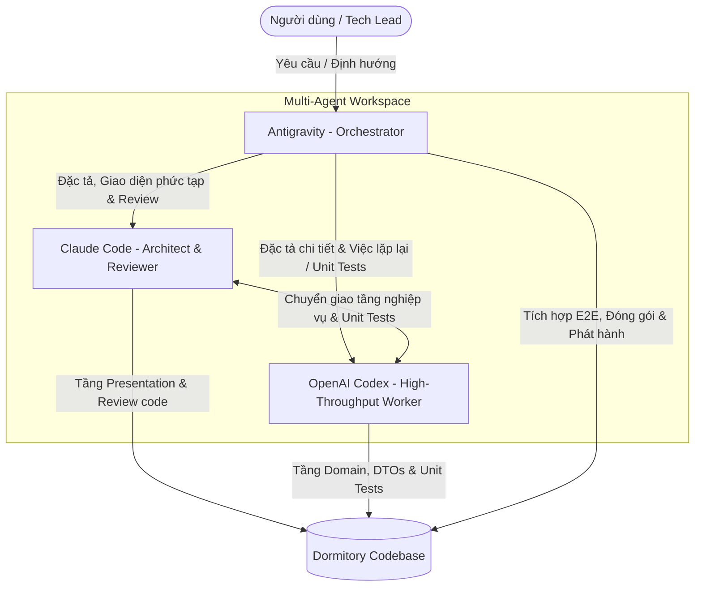

# Hướng Dẫn Phối Hợp Đa AI: Antigravity - Claude Code - OpenAI Codex

> **Tài liệu chuẩn hóa quy trình làm việc đa tác tử (Multi-Agent Collaboration Guide)** dành riêng cho dự án **Dormitory Manager**.  
> Áp dụng cho: **Antigravity**, **Claude Code**, **OpenAI Codex** và các công cụ AI khác cùng tham gia phát triển.

---

## 1. Nguyên Tắc & Triết Lý Phối Hợp

Nhằm tối ưu hóa hiệu quả phát triển, tiết kiệm token và tận dụng tối đa thế mạnh của từng mô hình AI, dự án áp dụng mô hình phân cấp **Tam Giác Phối Hợp (Tri-Agent Synergy)**:



### 3 Nguyên tắc cốt lõi:
1. **Đúng năng lực - Tiết kiệm Token (Token-Efficiency First)**: Các công việc mang tính lặp lại, có mẫu sẵn (boilerplate, DTOs, sinh hàng loạt Unit Tests, CRUD) được giao cho **Codex** thực hiện theo checklist rõ ràng, tránh để Claude Code tiêu tốn token vào các tác vụ cơ học.
2. **Một nguồn chân lý (Single Source of Truth)**: Mọi quy ước kiến trúc, giao diện tệp và trạng thái dự án được lưu tại tài liệu gốc trong thư mục `docs/`, `AGENTS.md` và `CLAUDE.md`.
3. **Bằng chứng trước khi xác nhận (Evidence Before Assertion)**: Bất kỳ AI nào trước khi báo hoàn thành nhiệm vụ đều phải chạy kiểm thử xác thực (`dotnet test`) và kiểm tra an toàn đồ thị mã nguồn qua **GitNexus**.

---

## 2. Bản Đồ Phân Công Vai Trò (Role Division Matrix)

| Tiêu chí | Antigravity (Orchestrator) | Claude Code (Architect & UI/UX) | OpenAI Codex (Worker) |
| :--- | :--- | :--- | :--- |
| **Vai trò chính** | Tổng chỉ huy, Quản lý lộ trình & Tích hợp | Kiến trúc sư hệ thống, UI/UX Avalonia & Reviewer | Lập trình viên thực thi tác vụ mẫu hóa |
| **Phạm vi sở trường** | - Quản lý Roadmap & Phân rã Phase<br>- Viết đặc tả nghiệp vụ (`docs/phaseX/`)<br>- Tích hợp E2E đa phân hệ<br>- CI/CD Packaging & GitHub Releases | - Thiết kế giao diện Avalonia UI (AXAML)<br>- Xử lý ViewModel & Reactive logic<br>- Tái cấu trúc kiến trúc phức tạp<br>- Độc lập Code Review & Quality Assurance | - Sinh Domain Entities, Enums, Value Objects<br>- Sinh DTOs & Mappings<br>- Sinh hàng loạt Unit Tests cho Services/DTOs<br>- Viết EF Core Migrations, Seed Data<br>- Viết các thuật toán xử lý dữ liệu theo interface |
| **Mức độ tiêu thụ Token** | Điều phối vĩ mô, ngữ cảnh trung bình | Ngữ cảnh sâu, phân tích chi tiết, tối ưu chất lượng | Nhỏ gọn, tập trung vào code khối, chi phí token tối ưu |
| **Khi nào giao việc?** | Người dùng đưa ra bài toán mới hoặc cần chốt phát hành | Cần dựng View, ViewModel, refactor sâu, hoặc review PR | Có sẵn Interface/Đặc tả cần viết implementation, test lặp lại |

---

## 3. Các Quy Tắc Bất Biến (Immutable Invariants)

Tất cả các AI khi thao tác trên mã nguồn **BẮT BUỘC TUÂN THỦ 100%**:

### 3.1. Quy ước ngôn ngữ & định danh (Language & Naming)
1. **Mã nguồn C# (Identifiers)**:
   - 100% tiếng Anh cho: Tên Class, Interface, Method, Property, Variable, File, Namespace, Enum.
   - **TUYỆT ĐỐI KHÔNG DÙNG `KTX`**: Luôn sử dụng từ khóa `Dormitory` (Ví dụ: `DormitoryDbContext`, `Dormitory.Core`, `IDormitoryService`).
2. **Giao tiếp, Tài liệu & Giao diện (User-Facing Text & Docs)**:
   - 100% tiếng Việt cho: Text hiển thị trên UI (Views, Dialogs, Nút bấm, Bảng dữ liệu, Cảnh báo), Thông báo lỗi, Comments mã nguồn, XML documentation, Markdown trong `docs/` và `README.md`.

### 3.2. Quy tắc kiến trúc (Clean Architecture 4 Tầng)
- `src/Dormitory.Core`: Chỉ chứa Domain Entities, Enums, Value Objects. **Không phụ thuộc vào bất kỳ thư viện ngoài nào (kể cả EF Core hay Avalonia)**.
- `src/Dormitory.Application`: Chứa Interfaces (`IService`), DTOs, Request/Response contracts, Các hằng số nghiệp vụ.
- `src/Dormitory.Infrastructure`: Chứa Triển khai Service (`ServiceImpl`), `DormitoryDbContext`, EF Core Migrations, Các tích hợp ngoại vi (ClosedXML, QuestPDF, MailKit, BCrypt, HttpListener).
- `src/Dormitory.Desktop`: Tầng Presentation với Avalonia UI 11, MVVM (`CommunityToolkit.Mvvm`), Views, ViewModels, Dialogs, Converters.
- `tests/`: Gồm `Dormitory.UnitTests` (Kiểm thử đơn vị) và `Dormitory.E2ETests` (Kiểm thử tự động Headless UI).

### 3.3. Quy tắc kiểm thử & GitNexus
- **Trước khi sửa đổi mã nguồn**: Phải chạy GitNexus impact (`node .gitnexus/run.cjs impact "symbolName" --direction upstream --repo .`) để nắm rõ các caller và phạm vi ảnh hưởng.
- **Trước khi hoàn thành hoặc commit**:
  1. Phải chạy `dotnet test` và đảm bảo **100% tests pass** (hiện có 498/498 tests).
  2. Phải chạy GitNexus detect changes (`node .gitnexus/run.cjs detect-changes --scope all --repo .`).

---

## 4. Quy Trình Chuyển Giao Công Việc (Agent Handoff Protocol)

Khi một AI (ví dụ Antigravity hoặc Claude Code) chuyển giao công việc cho AI khác (ví dụ Codex), hãy sử dụng mẫu **Handoff Ticket** chuẩn sau:

```markdown
### 📋 Handoff Ticket: [Tên Tác Vụ]
- **Target Agent**: [OpenAI Codex | Claude Code | Antigravity]
- **Mục tiêu (Objective)**: Mô tả ngắn gọn 1-2 câu về kết quả cần đạt được.
- **Tệp liên quan (Files in Scope)**:
  - `src/Dormitory.Core/Entities/XYZ.cs` (Tạo mới / Chỉnh sửa)
  - `src/Dormitory.Application/Services/IXYZService.cs` (Đã có sẵn interface)
  - `tests/Dormitory.UnitTests/Services/XYZServiceTests.cs` (Viết unit test)
- **Quy tắc an toàn & Ràng buộc (Safety Constraints)**:
  - C# identifiers 100% tiếng Anh, comments/XML docs 100% tiếng Việt.
  - Không thay đổi signature của các method hiện có.
- **Các bước thực hiện (Step-by-step)**:
  1. Bước 1...
  2. Bước 2...
- **Bằng chứng hoàn thành (Evidence Required)**:
  - Lệnh `dotnet test --filter ...` đạt 100% Passed.
  - Mã nguồn tuân thủ Clean Architecture.
```

---

## 5. Bảng Tra Cứu Lệnh Nhanh (Commands Cheat Sheet)

```bash
# 1. Biên dịch toàn bộ giải pháp
dotnet build

# 2. Chạy toàn bộ bộ kiểm thử (Unit Tests + E2E Tests)
dotnet test

# 3. Chạy riêng một nhóm kiểm thử
dotnet test --filter "FullyQualifiedName~Utility"

# 4. Chạy ứng dụng Desktop ở chế độ phát triển
dotnet run --project src/Dormitory.Desktop

# 5. Phân tích ảnh hưởng GitNexus trước khi sửa hàm/lớp
node .gitnexus/run.cjs impact "RecordBatchRoomAttendanceAsync" --direction upstream --repo .

# 6. Kiểm tra đồ thị mã nguồn GitNexus trước khi commit
node .gitnexus/run.cjs detect-changes --scope all --repo .

# 7. Đồng bộ lại index GitNexus khi có nhiều tệp mới
node .gitnexus/run.cjs analyze --index-only --repo .

# 8. Đóng gói ứng dụng đa nền tảng
bash scripts/package/build-macos.sh    # macOS DMG
bash scripts/package/build-windows.sh  # Windows ZIP
bash scripts/package/build-linux.sh    # Linux Tar.gz
```

---

## 6. Lộ Trình & Tài Liệu Tham Chiếu

- **Kiến trúc chi tiết**: Đọc [docs/architecture.md](file:///Volumes/AI_Models/source/Dormitory-Manager/docs/architecture.md)
- **Hướng dẫn sử dụng người dùng**: Đọc [docs/user-guide.md](file:///Volumes/AI_Models/source/Dormitory-Manager/docs/user-guide.md)
- **Đóng gói & CI/CD**: Đọc [docs/packaging-and-deployment.md](file:///Volumes/AI_Models/source/Dormitory-Manager/docs/packaging-and-deployment.md)
- **Đặc tả Phase 10 (v2.6.0)**: Đọc [docs/phase10/visitor-and-attendance-spec.md](file:///Volumes/AI_Models/source/Dormitory-Manager/docs/phase10/visitor-and-attendance-spec.md)
- **Đặc tả Phase 11 (Kế tiếp)**: Đọc [docs/phase11/spec-metering-tariffs.md](file:///Volumes/AI_Models/source/Dormitory-Manager/docs/phase11/spec-metering-tariffs.md)
