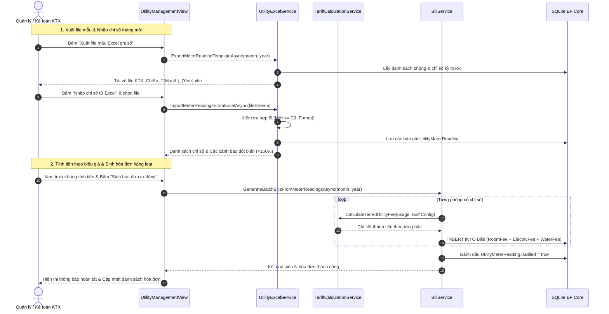

# Đặc Tả Kỹ Thuật: Nhập Chỉ Số Điện Nước Theo Lô & Biểu Giá Bậc Thang (Phase 11)

> **Tài liệu đặc tả kỹ thuật chi tiết** dành cho Phân hệ Quản lý Chỉ số Điện Nước, Biểu giá Bậc thang Lũy tiến và Tự động Sinh Hóa đơn Hàng loạt cho dự án **Dormitory Manager v2.7.0**.  
> Thiết kế để phân chia công việc tối ưu giữa **Antigravity**, **Claude Code** và **OpenAI Codex**.

---

## 1. Giới Thiệu & Bối Cảnh Nghiệp Vụ

### 1.1. Thực trạng & Vấn đề tồn đọng
Trong các phiên bản từ `v1.0.0` đến `v2.6.0`:
- Hóa đơn điện nước (`Bill`) chỉ hỗ trợ đơn giá phẳng cố định (`ElectricRate = 3500`, `WaterRate = 15000`).
- Người quản lý phải mở từng phòng để lập hóa đơn và gõ thủ công chỉ số công tơ điện nước cũ/mới, rất tốn thời gian với KTX có từ hàng chục đến hàng trăm phòng.
- Thiếu cơ chế phát hiện rò rỉ nước hoặc chập cháy tiêu thụ điện bất thường trước khi xuất hóa đơn cho sinh viên.
- Chưa có tính năng nhập hàng loạt từ file Excel (`.xlsx`) do nhân viên ghi điện nước nộp về.

### 1.2. Mục tiêu Phân hệ Phase 11
1. **Biểu giá Bậc thang Lũy tiến (Tiered Tariffs)**: Hỗ trợ cấu hình biểu giá điện bậc thang chuẩn EVN (hoặc linh hoạt theo quy định nội bộ KTX) và đơn giá nước theo khối/bậc.
2. **Quản lý Chỉ số Công tơ & Nhập theo Lô (Batch Meter Reading)**:
   - Xuất file Excel mẫu với chỉ số cũ tự động điền từ kỳ trước.
   - Nhập file Excel chỉ số mới với cơ chế kiểm tra lỗi định dạng và xác thực hợp lệ.
3. **Cảnh báo Bất thường (Anomaly Consumption Spike Warning)**: Cảnh báo khi mức tiêu thụ tháng này vượt quá 150% so với trung bình các tháng trước.
4. **1-Click Sinh Toàn Bộ Hóa Đơn (Bulk Bill Generation)**: Tự động tổng hợp tiền phòng (từ hợp đồng còn hiệu lực) + tiền điện nước tính theo biểu giá + phụ phí thành hóa đơn hoàn chỉnh cho từng phòng trong một giao dịch an toàn.

---

## 2. Kiến Trúc & Sơ Đồ Luồng Nghiệp Vụ



---

## 3. Cấu Trúc Dữ Liệu & Thực Thể (Domain Entities & Enums)

### 3.1. Enums (`src/Dormitory.Core/Enums/`)
```csharp
// UtilityType.cs
namespace Dormitory.Core.Enums;

public enum UtilityType
{
    Electricity = 1, // Điện
    Water = 2        // Nước
}
```

### 3.2. Thực thể Biểu giá (`UtilityTariff` & `TariffTier`)
```csharp
// UtilityTariff.cs
namespace Dormitory.Core.Entities;

public class UtilityTariff
{
    public int Id { get; set; }
    public string Name { get; set; } = string.Empty; // Ví dụ: "Biểu giá điện sinh hoạt 2026"
    public UtilityType Type { get; set; }
    public bool IsTiered { get; set; } = true; // true: Lũy tiến bậc thang; false: Đồng giá
    public decimal FlatRate { get; set; } // Đơn giá nếu IsTiered = false
    public bool IsActive { get; set; } = true;
    public DateTime CreatedAt { get; set; } = DateTime.Now;
    
    public ICollection<TariffTier> Tiers { get; set; } = new List<TariffTier>();
}

// TariffTier.cs
namespace Dormitory.Core.Entities;

public class TariffTier
{
    public int Id { get; set; }
    public int UtilityTariffId { get; set; }
    public UtilityTariff? UtilityTariff { get; set; }
    
    public int TierNumber { get; set; } // Bậc 1, 2, 3...
    public decimal FromUnit { get; set; } // Từ kWh/m3 (ví dụ: 0, 51, 101)
    public decimal? ToUnit { get; set; }  // Đến kWh/m3 (null nếu là bậc vô hạn)
    public decimal UnitPrice { get; set; } // Đơn giá bậc (VND)
}
```

### 3.3. Thực thể Ghi Chỉ Số Công Tơ (`UtilityMeterReading`)
```csharp
// UtilityMeterReading.cs
namespace Dormitory.Core.Entities;

public class UtilityMeterReading
{
    public int Id { get; set; }
    public int RoomId { get; set; }
    public Room? Room { get; set; }
    
    public int Month { get; set; }
    public int Year { get; set; }
    public DateTime ReadingDate { get; set; } = DateTime.Now;
    
    // Điện
    public decimal OldElectricIndex { get; set; }
    public decimal NewElectricIndex { get; set; }
    public decimal ElectricUsage => Math.Max(0, NewElectricIndex - OldElectricIndex);
    
    // Nước
    public decimal OldWaterIndex { get; set; }
    public decimal NewWaterIndex { get; set; }
    public decimal WaterUsage => Math.Max(0, NewWaterIndex - OldWaterIndex);
    
    // Trạng thái đối soát & lập hóa đơn
    public bool IsBilled { get; set; } = false;
    public int? BillId { get; set; }
    public Bill? Bill { get; set; }
    
    // Cảnh báo bất thường
    public bool HasElectricAnomaly { get; set; }
    public bool HasWaterAnomaly { get; set; }
    public string? AnomalyNotes { get; set; }
}
```

---

## 4. Phân Rã Công Việc Cho Các AI (Work Breakdown & Task Delegation)

| Task ID | Nội dung công việc | Phân công phụ trách | Mô tả & Bằng chứng nghiệm thu |
| :--- | :--- | :---: | :--- |
| **Task 1** | **Domain Entities & Enums**<br>- `UtilityType.cs`<br>- `UtilityTariff.cs`<br>- `TariffTier.cs`<br>- `UtilityMeterReading.cs` | 🤖 **Codex** | Sinh 4 tệp C# trong `src/Dormitory.Core`. Code English 100%, XML docs tiếng Việt 100%. `dotnet build` thành công. |
| **Task 2** | **EF Core Config, DbContext & Seed Data**<br>- Mapping trong `DormitoryDbContext`<br>- Migration tạo bảng SQLite<br>- Seed dữ liệu biểu giá điện EVN 6 bậc mẫu | 🤖 **Codex** | Cập nhật `DormitoryDbContext.cs`. Chạy migration hoặc migrate tự động khi khởi động. Test kết nối DB xanh. |
| **Task 3** | **Tariff Calculation Engine & Unit Tests**<br>- `ITariffCalculationService`<br>- `TariffCalculationService`<br>- Unit tests tính toán lũy tiến bậc thang | 🤖 **Codex** (Implementation & Tests)<br>+ 🧠 **Claude** (Review) | Xử lý thuật toán chia bậc chính xác đến từng đồng. Viết 15+ Unit tests kiểm tra các biên bậc thang. 100% tests pass. |
| **Task 4** | **Excel Import/Export Service & Parser Tests**<br>- `IUtilityExcelService` (ClosedXML)<br>- Xuất template Excel chuẩn<br>- Đọc và validate file Excel nộp về | 🤖 **Codex** (Parser & Unit Tests)<br>+ 🧠 **Claude** (Review) | Viết Unit tests mô phỏng file Excel hợp lệ, file chỉ số âm, file sai định dạng. Toàn bộ tests pass. |
| **Task 5** | **Presentation Layer: Avalonia UI & ViewModels**<br>- `UtilityManagementViewModel.cs`<br>- `UtilityBatchImportDialogViewModel.cs`<br>- `UtilityTariffDialogViewModel.cs`<br>- Views & Dialogs AXAML | 🧠 **Claude Code** (Chuyên gia UX & XAML) | Dựng giao diện đẹp mắt, bảng dữ liệu lọc theo phòng/tòa/tháng, highlight màu đỏ các dòng có chỉ số bất thường, nút bấm thao tác mượt mà. |
| **Task 6** | **Tích Hợp Bulk Bill Generation, E2E & Packaging**<br>- Nối `IBillService` sinh hóa đơn theo biểu giá<br>- Đăng ký DI trong `App.axaml.cs`<br>- Thêm menu sidebar `⚡ Điện Nước`<br>- Viết Headless E2E Test | 🌟 **Antigravity** (Orchestrator) | Toàn bộ 510+ tests pass (bao gồm E2E test cho hành trình import & sinh bill). Đóng gói và phát hành `v2.7.0`. |

---

## 5. Quy Chuẩn Kiểm Thử & Tiêu Chí Hoàn Thành (Quality Gates)

1. **Unit Test Coverage**:
   - Thuật toán chia bậc điện nước phải có test cho: Tiêu thụ = 0, Tiêu thụ nằm trọn trong Bậc 1, Tiêu thụ chạm biên Bậc 2/3, Tiêu thụ vượt bậc cao nhất, Biểu giá đồng giá (FlatRate).
   - Parser Excel phải có test cho: Dữ liệu trống, Chỉ số mới nhỏ hơn chỉ số cũ, Phòng không tồn tại, Format file không phải `.xlsx`.
2. **Kiểm tra đồ thị GitNexus**:
   - Chạy `impact` trước khi sửa đổi `Bill.cs` hoặc `IBillService.cs`.
   - Chạy `detect_changes` trước mỗi commit.
3. **Bảo toàn số lượng Test**:
   - Bộ test hiện tại (498/498 tests) không được phép bị gãy bất kỳ test nào sau khi tích hợp Phase 11.
